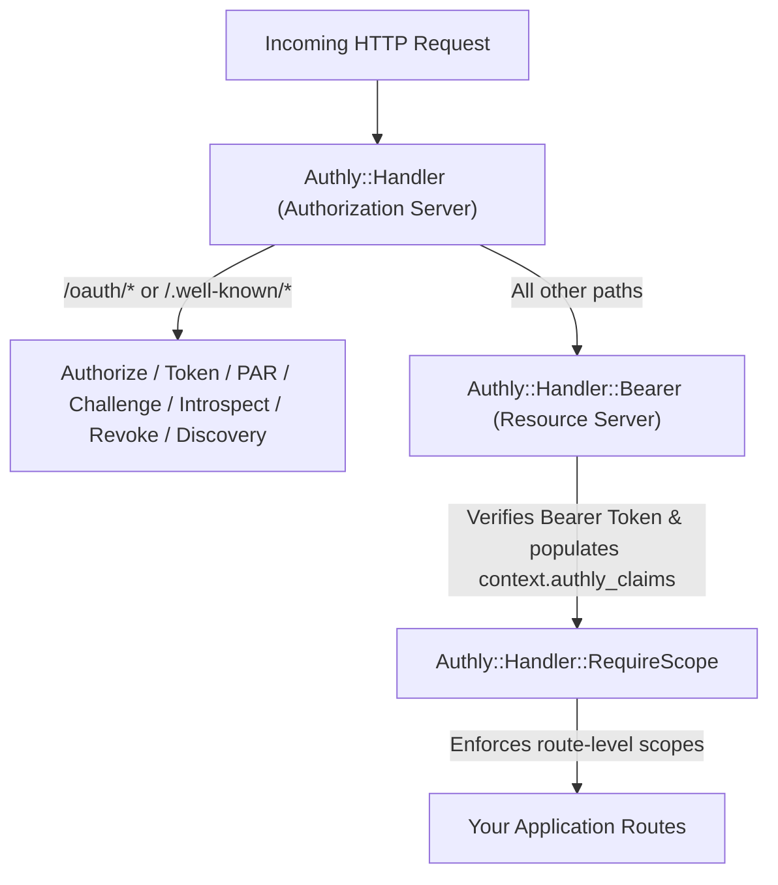

# Architecture & Design Principles

Authly is designed as a composable, zero-framework Crystal OAuth2 and OpenID Connect shard built directly on Crystal's standard `HTTP::Handler`.

---

## 1. Separation of Authorization Server and Resource Server

Authly separates **issuing credentials** from **verifying credentials on API requests**:



- **Co-located Deployment**: Mount `Authly::Handler`, `Authly::Handler::Bearer`, and `Authly::Handler::RequireScope` in the same `HTTP::Server` (exempting `/oauth` and `/.well-known` on `Bearer`).
- **Separate Microservices**: Run `Authly::Handler` on a dedicated Authorization Server (`auth.example.com`) and run `Authly::Handler::Bearer` on independent Resource Servers (`api.example.com`), verifying JWTs via the published public key (`config.public_key` or `config.verification_keys`).

---

## 2. Why Authly Does Not Own User Login

Interactive OAuth2 endpoints (`/oauth/authorize` and `/device`) act on behalf of a signed-in human user (the **resource owner**). Authly deliberately does not implement password login forms, session cookies, or MFA screens. Instead, the host application supplies `config.authenticate_user`:

```crystal
config.authenticate_user = ->(context : HTTP::Server::Context) { MySession.current_user_id(context) }
```


This boundary provides two critical security properties:
1. **No Untrusted Subject Parameters**: Authly never reads `user_id` or `consent` from query strings or POST bodies. The authenticated owner's identity comes exclusively from `config.authenticate_user`.
2. **Fail-Closed by Default**: Until `config.authenticate_user` is configured, `/oauth/authorize` and `/device` refuse every request rather than issuing tokens for an unverified user.


---

## 3. Pluggable Store Architecture

Authly isolates all state behind six focused interfaces so each concern can be backed by the right storage primitive:

| Interface | What It Stores | Key Requirement |
| :--- | :--- | :--- |
| `TokenStore` | Opaque token payloads, revoked `jti`s, and refresh token families | Atomic `consume(jti)` and `StoreUnavailable` signaling |
| `StateStore` | Anti-CSRF nonces for consent and device forms | Atomic single-use `consume(state)` |
| `ChallengeStore` | Cryptographic challenge nonces (`POST /oauth/challenge`) | Atomic single-use `consume!` / `record_attempt!` |
| `PARStore` | Pushed authorization request parameters (`request_uri`) | Atomic single-use `consume(request_uri)` |
| `DeviceCodeStore` | Device flow `device_code` and `user_code` state | Indexed by both `device_code` and `user_code` |
| `AttemptLimiter` | Rate-limit counters per source/owner within a sliding window | Atomic `increment(key, window)` and fail-closed capacity |


[custom-stores-and-models.md](../how-to/custom-stores-and-models.md)

