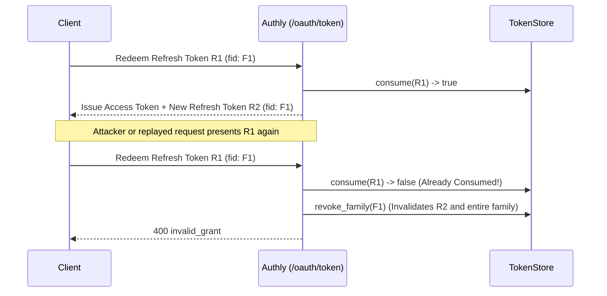

# Token Strategies & Refresh Token Lifecycle

Authly supports two token strategies (`:jwt` and `:opaque`) and implements OAuth 2.1 / Security BCP refresh token rotation with family-level replay detection.

---

## 1. JWT vs. Opaque Access Tokens



- **Self-Contained**: Access tokens and refresh tokens are signed JSON Web Tokens containing `sub`, `iss`, `cid`, `scope`, `jti`, `iat`, `exp`, and optional `aud` and `cnf` claims.
- **Stateless Verification**: Resource servers verify signatures and claims locally without a database lookup, consulting `TokenStore#revoked?(jti)` only for revocation checks.
- **Best For**: Distributed microservices and high-throughput APIs.



- **Reference Tokens**: Access and refresh tokens are 256-bit cryptographically random hex strings (`Random::Secure.hex(32)`).
- **Zero Client-Visible Metadata**: Token claims (`cid`, `sub`, `scope`, `exp`, `cnf`) are stored exclusively server-side in `Authly.config.token_store`.
- **Best For**: Environments where token claims must remain confidential from clients or where immediate centralized revocation is required.



---

## 2. Strict Separation of Access and Refresh Tokens

Every token issued by Authly carries an explicit `"token_type"` claim (`"access_token"` or `"refresh_token"`):


`Authly::Handler::Bearer`, `Authly.valid?`, and `POST /oauth/introspect` **only accept `"access_token"`**. Presenting a refresh token as a Bearer token on an API route or to `/oauth/introspect` is always rejected, even though both tokens are signed with the same key.


---

## 3. Refresh Token Rotation & Family Reuse Detection

When a refresh token is redeemed at `POST /oauth/token` (`grant_type=refresh_token`):

1. **Single-Use Consumption**: Authly calls `token_store.consume(jti)` to atomically mark the presented refresh token as used.
2. **Rotation within a Family (`fid`)**: A new access token and a **new** refresh token are issued, carrying the same rotation family ID (`fid`).
3. **Replay / Theft Detection**: If an already-consumed refresh token is presented a second time (indicating either a network replay or that an attacker stole the token and raced the legitimate client), Authly immediately calls `RefreshToken.revoke_family(fid)`. Every refresh token in that family is invalidated, forcing a fresh sign-in.
4. **Absolute Family Lifetime (`fexp`)**: Continuous rotation cannot extend a session indefinitely. Every refresh token family carries an absolute expiration timestamp (`fexp`, controlled by `config.refresh_absolute_ttl = 30.days`). No rotated refresh token can outlive its family's `fexp`.
5. **Scope Narrowing**: A refresh request may omit `scope` (retaining the original scope) or request a narrower subset of scopes. Even when an access token is narrowed, the replacement refresh token preserves the original granted scope so subsequent refreshes can request other subsets of the original grant.
