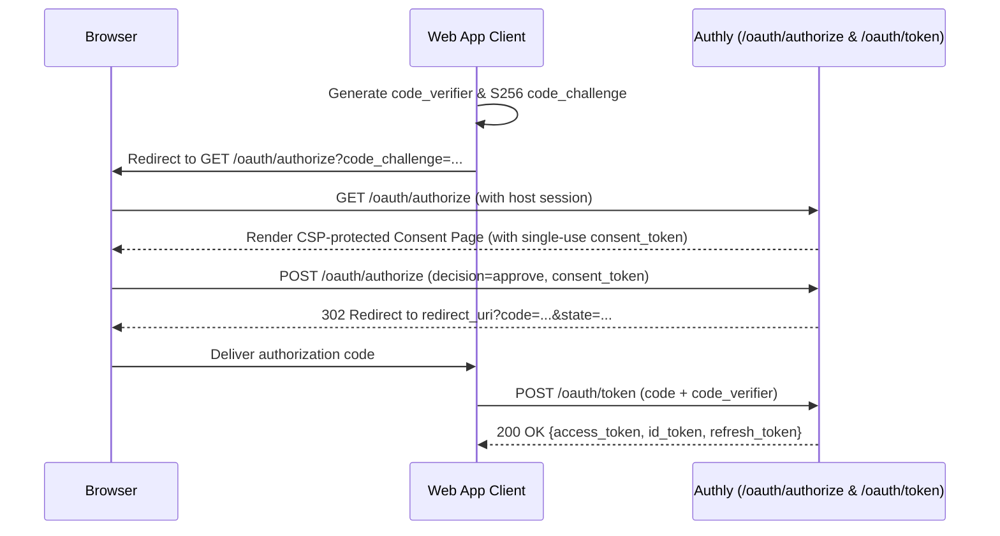

# Interactive Sign-In with PKCE & OIDC

In this tutorial, you will configure an interactive **Authorization Code with PKCE (`S256`)** flow and **OpenID Connect (`openid`)** ID token issuance in Authly.


**Host-Owned Login Boundary**
Authly never reads `user_id` or `consent` from request parameters. Your host application supplies the signed-in user's ID exclusively via `config.authenticate_user`. While `authenticate_user` is unset, `/oauth/authorize` and `/device` refuse every request.




---



### Configure PKCE Enforcement & Session Authentication

Configure Authly to enforce PKCE (`S256`) and resolve the signed-in user from your application's session:

```crystal title="pkce_tutorial.cr" lineNumbers="true"
require "http/server"
require "digest/sha256"
require "base64"
require "authly"

Authly.configure do |config|
  config.issuer = "http://localhost:8080"
  config.base_url = "http://localhost:8080"
  config.secret_key = "tutorial-secret-key-at-least-32-bytes"

  # Enforce PKCE with S256 on all authorization_code requests
  config.enforce_pkce = true
  config.enforce_pkce_s256 = true

  # Resolve the signed-in user from the host application's session
  config.authenticate_user = ->(ctx : HTTP::Server::Context) {
    ctx.request.headers["X-Session-User"]?.presence
  }
end

# Register a client and a resource owner
Authly.clients << Authly::Client.new(
  name: "Web App",
  secret: "webapp-secret",
  redirect_uri: "http://localhost:3000/callback",
  id: "webapp",
  scopes: "openid profile read",
  grant_types: "authorization_code refresh_token",
)

Authly.owners << Authly::Owner.new("alice", "password123")
```



### Generate a PKCE Verifier & `S256` Challenge

Before redirecting the user to `/oauth/authorize`, the client generates a high-entropy `code_verifier` and computes its URL-safe Base64 SHA-256 hash (`code_challenge`):

```crystal title="pkce_tutorial.cr"
code_verifier = Random::Secure.hex(32)
code_challenge = Base64.urlsafe_encode(
  Digest::SHA256.digest(code_verifier),
  padding: false
)
```



### Issue and Exchange the Authorization Code

Once the user approves the consent screen at `/oauth/authorize`, Authly issues a signed, single-use authorization code bound to `client_id`, `redirect_uri`, `code_challenge`, `user_id`, and `nonce`. Exchange it at `POST /oauth/token`:



```crystal title="pkce_tutorial.cr"
code = Authly::Code.new(
  client_id: "webapp",
  scope: "openid read",
  redirect_uri: "http://localhost:3000/callback",
  challenge: code_challenge,
  method: "S256",
  user_id: "alice",
  nonce: "n-0S6_WzA2Mj",
).to_s

token = Authly.access_token(
  "authorization_code",
  client_id: "webapp",
  client_secret: "webapp-secret",
  redirect_uri: "http://localhost:3000/callback",
  code: code,
  verifier: code_verifier,
)

puts "Access Token: #{token.access_token}"
puts "ID Token:     #{token.id_token}"
puts "Subject:      #{token.sub}"
```



```http
POST /oauth/token HTTP/1.1
Content-Type: application/x-www-form-urlencoded

grant_type=authorization_code&
client_id=webapp&
client_secret=webapp-secret&
redirect_uri=http%3A%2F%2Flocalhost%3A3000%2Fcallback&
code=<AUTHORIZATION_CODE>&
code_verifier=<CODE_VERIFIER>
```





---

## Next Steps


[fapi-and-advanced-security.md](../how-to/fapi-and-advanced-security.md)

