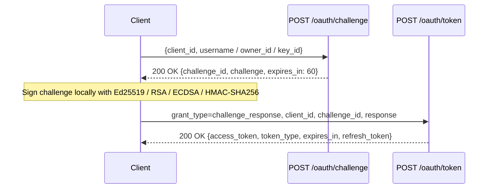

# Cryptographic Challenge-Response Auth

In this tutorial, you will authenticate a client and a resource owner using Authly's **Challenge-Response** flow (`POST /oauth/challenge` and `POST /oauth/token` with `grant_type=challenge_response` or `urn:ietf:params:oauth:grant-type:challenge`).



---



### Configure Authly & Register Cryptographic Keys

Configure `challenge_ttl` (`60.seconds` by default) and `challenge_max_attempts` (`1` by default) and register an owner or client with an asymmetric public key or HMAC secret:

```crystal title="challenge_demo.cr" lineNumbers="true"
require "authly"
require "ed25519"
require "openssl/hmac"

Authly.configure do |config|
  config.issuer = "https://auth.example.com"
  config.secret_key = "demo-jwt-signing-secret-key"
  config.challenge_ttl = 60.seconds
  config.challenge_max_attempts = 1
end

# 1. Register a client authorized for challenge_response
Authly.clients << Authly::Client.new(
  name: "CLI Client",
  secret: "cli-shared-hmac-secret",
  redirect_uri: "https://cli.example.com/callback",
  id: "cli-client",
  scopes: "read write",
  grant_types: "challenge_response urn:ietf:params:oauth:grant-type:challenge refresh_token",
)

# 2. Register an owner with an Ed25519 public key
signing_key = Ed25519::SigningKey.new
public_key_hex = signing_key.verify_key.key_bytes.hexstring

Authly.owners << Authly::Owner.new(
  username: "alice",
  password: "",
  public_key: public_key_hex,
  key_id: "alice-ed25519-key",
  id: "user-alice-01",
)
```



### Request a Single-Use Challenge (`POST /oauth/challenge`)

Request a challenge nonce bound to `client_id` and optional `username`, `owner_id`, or `key_id`:



```http
POST /oauth/challenge HTTP/1.1
Content-Type: application/json

{
  "client_id": "cli-client",
  "username": "alice",
  "key_id": "alice-ed25519-key"
}
```

Response (`200 OK`):

```json
{
  "challenge_id": "4f8c1d7e2a9b0c3d5e6f7a8b9c0d1e2f",
  "challenge": "a3f19b8c7d6e5f4a3b2c1d0e9f8a7b6c5d4e3f2a1b0c9d8e7f6a5b4c3d2e1f0a",
  "expires_in": 60
}
```



```crystal
challenge_data = Authly::ChallengeResponse.create_challenge(
  client_id: "cli-client",
  username: "alice",
  key_id: "alice-ed25519-key",
)
```





### Sign the Challenge & Exchange for an Access Token (`POST /oauth/token`)

Sign `challenge_data.challenge` using your chosen algorithm and exchange it at `/oauth/token`:



```crystal
sig_bytes = signing_key.sign(challenge_data.challenge.to_slice)
response_hex = sig_bytes.hexstring

token = Authly.access_token(
  "challenge_response",
  client_id: "cli-client",
  challenge_id: challenge_data.challenge_id,
  response: response_hex,
  scope: "read write",
)
```



```crystal
rsa_key = OpenSSL::PKey::RSA.new(2048)
sig_bytes = rsa_key.sign(OpenSSL::Digest.new("sha256"), challenge_data.challenge)
response_b64 = Base64.strict_encode(sig_bytes)
```



```crystal
ec_key = OpenSSL::PKey::EC.generate("P-256")
digest = OpenSSL::Digest.new("sha256").update(challenge_data.challenge).final
sig_bytes = ec_key.ec_sign(digest)
response_b64 = Base64.strict_encode(sig_bytes)
```



```crystal
response_hex = OpenSSL::HMAC.hexdigest(
  :sha256,
  "cli-shared-hmac-secret",
  challenge_data.challenge
)
```






**Replay & Brute-Force Protection Built In**
With `config.challenge_max_attempts = 1` (the default), every challenge is atomically consumed on the first verification attempt—whether the signature succeeds or fails. Replaying a consumed challenge returns `400 invalid_grant`, and presenting an expired challenge returns `400 expired_challenge`.


---

## Next Steps


[custom-stores-and-models.md](../how-to/custom-stores-and-models.md)

