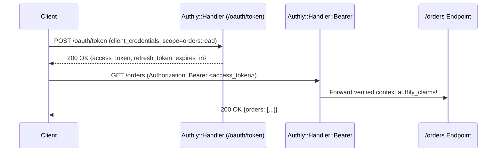

# Getting Started: First OAuth2 Server & API

In this tutorial, you will build a single Crystal HTTP server that acts as both an **OAuth2 Authorization Server** and a **Protected Resource API**. By the end, you will issue a JWT access token using the `client_credentials` grant and use it to call a scope-protected `/orders` endpoint.


**Prerequisites**
- Crystal `>= 1.22.0` (`crystal --version`)
- `curl` (for testing HTTP endpoints)




---



### Create the Crystal Project & Install Authly

Initialize a new Crystal project and add `authly` to `shard.yml`:



```bash
mkdir authly_demo && cd authly_demo
crystal init app authly_demo
```



```yaml title="shard.yml"
name: authly_demo
version: 0.1.0

dependencies:
  authly:
    github: azutoolkit/authly
```



Install dependencies:

```bash
shards install
```



### Configure Authly & Register a Client

Replace `src/authly_demo.cr` with the following server implementation. We mount three handlers in `HTTP::Server`:
1. `Authly::Handler` — Serves `/oauth/*` and `/.well-known/*` endpoints.
2. `Authly::Handler::Bearer` — Verifies Bearer tokens on all routes except `/health`, `/oauth/*`, and `/.well-known/*`.
3. `Authly::Handler::RequireScope` — Requires the `orders:read` scope on `/orders`.

```crystal title="src/authly_demo.cr" lineNumbers="true"
require "http/server"
require "json"
require "authly"

# 1. Configure the Authorization Server
Authly.configure do |config|
  config.issuer = "http://localhost:8080"
  config.base_url = "http://localhost:8080"
  config.secret_key = "super-secret-signing-key-for-tutorial-only"
  config.token_strategy = :jwt
  config.algorithm = JWT::Algorithm::HS256
  config.access_ttl = 15.minutes
end

# 2. Register an OAuth2 Client
Authly.clients << Authly::Client.new(
  name: "Orders Service",
  secret: "orders-client-secret",
  redirect_uri: "http://localhost:8080/callback",
  id: "orders-service",
  scopes: "orders:read orders:write",
  grant_types: "client_credentials refresh_token",
)

# 3. Define the Resource Server application handler
app = HTTP::Handler::HandlerProc.new do |context|
  case context.request.path
  when "/health"
    context.response.content_type = "application/json"
    context.response.print({status: "ok"}.to_json)
  when "/orders"
    claims = context.authly_claims!
    context.response.content_type = "application/json"
    context.response.print({
      client_id: claims.client_id,
      subject:   claims.subject,
      scopes:    claims.scopes,
      orders:    [{id: 101, total: "49.99"}],
    }.to_json)
  else
    context.response.status_code = 404
    context.response.print("Not Found")
  end
end

# 4. Assemble the HTTP::Server handler chain
server = HTTP::Server.new([
  Authly::Handler.new,
  Authly::Handler::Bearer.new(
    realm: "orders-api",
    except_exact: ["/health"],
    except: ["/oauth", "/.well-known"],
  ),
  Authly::Handler::RequireScope.all("orders:read", prefixes: ["/orders"]),
  app,
])

address = server.bind_tcp("127.0.0.1", 8080)
puts "Listening on http://#{address}"
server.listen
```

Start the server:

```bash
crystal run src/authly_demo.cr
```



### Verify Unprotected and Protected Routes

Test `/health` (exempted via `except_exact`) and `/orders` (protected by `Bearer`):



```bash
curl -i http://127.0.0.1:8080/health
```

```http
HTTP/1.1 200 OK
Content-Type: application/json

{"status":"ok"}
```



```bash
curl -i http://127.0.0.1:8080/orders
```

```http
HTTP/1.1 401 Unauthorized
WWW-Authenticate: Bearer realm="orders-api"
Cache-Control: no-store
Content-Type: application/json

{}
```





### Issue an Access Token & Call `/orders`

Request an access token from `POST /oauth/token` and pass it in the `Authorization: Bearer` header:



```bash
curl -s -X POST http://127.0.0.1:8080/oauth/token \
  -u "orders-service:orders-client-secret" \
  -d "grant_type=client_credentials&scope=orders:read"
```

```json
{
  "sub": "orders-service",
  "jti": "9a8b7c6d...",
  "access_token": "eyJ0eXAiOiJKV1QiLCJhbGciOiJIUzI1NiJ9...",
  "token_type": "Bearer",
  "scope": "orders:read",
  "expires_in": 900,
  "refresh_token": "eyJ0eXAiOiJKV1QiLCJhbGciOiJIUzI1NiJ9..."
}
```



```bash
TOKEN="<paste-access-token>"
curl -s http://127.0.0.1:8080/orders \
  -H "Authorization: Bearer $TOKEN"
```

```json
{
  "client_id": "orders-service",
  "subject": "orders-service",
  "scopes": ["orders:read"],
  "orders": [{"id": 101, "total": "49.99"}]
}
```





---

## Next Steps


[authorization-code-pkce.md](authorization-code-pkce.md)



[challenge-response-auth.md](challenge-response-auth.md)

